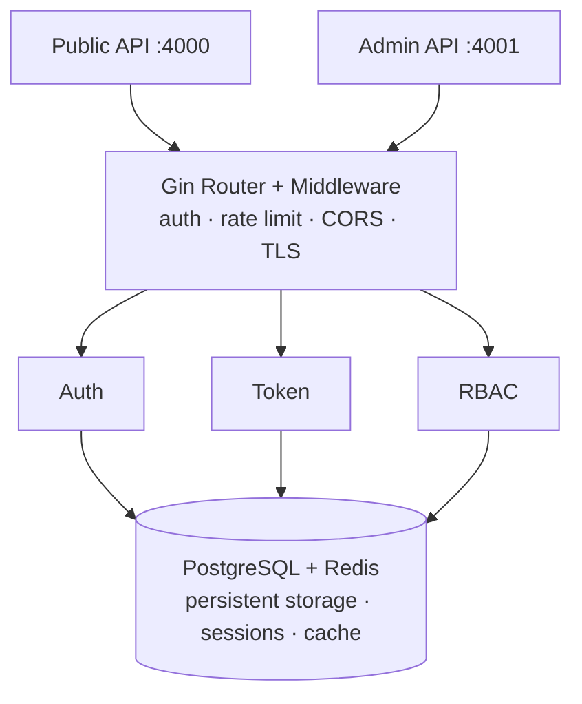

# Auth Service

[](https://go.dev)
[](./LICENSE)
[](https://pages.nist.gov/800-63-4/)

## About

Authentication and authorization service for the QuantFlow Studio ecosystem. Serves two client types: **Users** (humans) and **Systems** (services and AI agents). Built on OAuth 2.1 with mandatory PKCE, asymmetric JWT signing, and NIST SP 800-63-4 AAL2 compliance.

## Features

- **OAuth 2.1** — Authorization Code + PKCE, Client Credentials; no implicit or ROPC grants
- **Asymmetric JWT** — ES256 / EdDSA signing with JWKS endpoint
- **Dual Client Model** — Users (interactive) and Systems (machine-to-machine)
- **Argon2id Password Hashing** — 19 MiB memory, 2 iterations, HMAC pepper
- **NIST Password Policy** — 15-char minimum, breached-password blocklist, no composition rules. New passwords (register, reset confirm, change, admin user create) are checked against HIBP Pwned Passwords via the k-anonymity range API (only a 5-char SHA-1 prefix leaves the service; 3 s timeout). The check **fails open**: if HIBP is unreachable the password is accepted, a `WARN` is logged and a `password_breach_check_failed` audit event is emitted. Breached passwords are rejected with `400` and a `password_breached` audit event.
- **Token Security** — Prefixed tokens (`qf_at_`, `qf_rt_`, `qf_ac_`, `qf_ak_`), only signatures stored in DB
- **Dual-Port Architecture** — Public (:4000) and Admin (:4001). Every `/admin/*` route requires a static bearer token (`ADMIN_API_TOKENS`) in addition to network-level isolation
- **Rate Limiting** — Per-IP with progressive delay and account lockout
- **DPoP Support** — Demonstrating Proof-of-Possession token binding
- **MFA** — TOTP with backup codes
- **Social Login** — Google, GitHub, Apple OAuth providers
- **OIDC Provider** — OpenID Connect discovery and ID tokens; PKCE (S256) required for every client, requested scopes validated against the client and `OIDC_SUPPORTED_SCOPES`, scope-gated `/userinfo`
- **SAML SSO** — Service Provider integration
- **Multi-Tenancy** — Subdomain and header-based tenant resolution

## Quick Start

### Prerequisites

- Go 1.26+
- PostgreSQL 15+
- Redis 7+
- Docker & Docker Compose (optional)

### Run with Docker Compose

```bash
# Start all dependencies
docker-compose up -d

# Run migrations
go run cmd/migrate/main.go up

# Start the service
go run cmd/server/main.go
```

### Run locally

```bash
# Copy and edit environment variables
cp .env.example .env

# Start dependencies
docker-compose up -d postgres redis

# Run migrations
go run cmd/migrate/main.go up

# Start the service
source .env && go run cmd/server/main.go
```

## Account-State Disclosure

Public endpoints do not reveal whether an account exists or what state it is in:

- **Login** verifies the password first (an unknown email costs one dummy
  Argon2id verification, so timing matches). Unknown email, wrong password,
  locked and suspended accounts all return `401 invalid credentials`; `account
  locked` / `account suspended` are returned only after a correct password.
- **Register** with an address that already has an account returns the same
  `201` and body shape as a new registration (with a placeholder `id`). When
  `EMAIL_ENABLED=true` the existing owner receives an "account already exists"
  email. No `409` is returned; no new configuration.
- **Password reset** requests send the email in the background (15 s timeout,
  failures logged and audited), so response time does not depend on whether the
  address exists.
- **`POST /oauth/token`** errors use the RFC 6749 §5.2 body
  `{"error", "error_description"}` with a fixed description per code
  (`invalid_request`, `invalid_client` 401, `invalid_grant` 400,
  `unsupported_grant_type`, `server_error`). Which check failed (client, code
  binding, redirect URI, PKCE verifier) is logged server-side only.

## API Surface

| Method | Endpoint | Description |
|--------|----------|-------------|
| POST | `/auth/register` | Register a new user |
| POST | `/auth/login` | Authenticate and obtain tokens |
| POST | `/auth/token/refresh` | Refresh an access token |
| POST | `/auth/token/revoke` | Revoke a refresh token |
| POST | `/auth/password/reset` | Request password reset |
| POST | `/auth/password/reset/confirm` | Confirm password reset |
| GET | `/.well-known/jwks.json` | JSON Web Key Set |
| GET | `/.well-known/openid-configuration` | OIDC discovery document |
| POST | `/oauth/authorize` | OAuth 2.1 authorization |
| POST | `/oauth/token` | OAuth 2.1 token exchange |
| GET | `/admin/clients` | List OAuth clients (admin) |
| POST | `/admin/clients` | Create OAuth client (admin) |
| POST | `/admin/clients/:id/approve` | Approve a third-party client (admin; was `GET` before GH-524) |
| GET | `/health` | Health check |
| GET | `/ready` | Readiness probe |

Full API specification: [`api/`](./api/)

### Admin API authentication

Every `/admin/*` route on :4001 needs `Authorization: Bearer <token>`, where
the token is one of the comma-separated `ADMIN_API_TOKENS` (each at least 32
bytes; generate with `./scripts/generate-secret.sh --name ADMIN_API_TOKENS --bytes 32 --format hex`).
Missing or wrong credentials return `401`; `/health` stays unauthenticated.

- **Rotation:** two tokens are accepted at once. Deploy `ADMIN_API_TOKENS=<new>,<old>`,
  move callers to `<new>`, then deploy `ADMIN_API_TOKENS=<new>`.
- **Unset:** the service still starts (the public API stays up), logs one `ERROR`
  at startup, and every `/admin/*` route returns `503` with code `admin_api_disabled`.
- Admin request bodies are capped by the same limit as the public API (`413`).
- **Deploy order:** add `ADMIN_API_TOKENS` to the task definition / env file
  *before* deploying this release, and give existing admin callers the token
  first — otherwise their calls start failing with `503`.

## Webhooks

Admin-registered webhooks (`/admin/webhooks`) deliver audit events as signed
HTTPS POSTs.

**Target restrictions.** Webhook URLs must use `https`, must not embed
credentials, and must not point at `localhost` or an IP literal in a loopback,
private (RFC 1918), link-local (incl. `169.254.0.0/16`), CGNAT
(`100.64.0.0/10`), unique-local IPv6 or other reserved range. The same ranges
are refused again when the dispatcher connects, *after* DNS resolution, so a
hostname that resolves (or later rebinds) to an internal address is rejected.
Redirects are never followed: a `3xx` answer is recorded as the delivery
status code. Delivery timeout is 5 s.

**Response data.** The target's response body is not read or stored; deliveries
record only the status code (`response_body` is no longer returned by
`GET /admin/webhooks/:id/deliveries`).

**Verifying signatures.** Each request carries:

| Header | Value |
|--------|-------|
| `X-Webhook-Timestamp` | Unix time (seconds) at which the request was signed |
| `X-Signature-256` | `sha256=` + hex `HMAC-SHA256(secret, timestamp + "." + raw_body)` |
| `X-Webhook-Event` / `X-Webhook-Delivery` | Event type / delivery ID |

Receivers should recompute the HMAC over the timestamp header, a literal `.`
and the raw request body, compare in constant time, and reject requests whose
timestamp is outside a tolerance (e.g. 5 minutes) to prevent replay:

```go
mac := hmac.New(sha256.New, []byte(secret))
mac.Write([]byte(ts + "."))
mac.Write(rawBody)
ok := hmac.Equal([]byte("sha256="+hex.EncodeToString(mac.Sum(nil))), []byte(sigHeader))
```

> **Breaking change:** signatures previously covered the body only. Receivers
> must be updated to include the timestamp. No new configuration is required.

## Architecture



See [architecture diagrams](./.agent/system/architecture-diagrams.md) and [project architecture](./.agent/system/project-architecture.md) for details.

## Configuration

All configuration is via environment variables. See [`internal/config/config.go`](./internal/config/config.go) for the full source.

### Required Variables

| Variable | Description |
|----------|-------------|
| `APP_ENV` | Environment: `development`, `staging`, or `production` |
| `POSTGRES_HOST` | PostgreSQL host |
| `POSTGRES_DB` | PostgreSQL database name |
| `POSTGRES_USER` | PostgreSQL user |
| `POSTGRES_PASSWORD` | PostgreSQL password |
| `REDIS_HOST` | Redis host |
| `JWT_PRIVATE_KEY_PATH` | Path to JWT private key file |
| `SYSTEM_SECRETS` | Comma-separated secrets (newest first for rotation) |
| `PASSWORD_PEPPER` | HMAC pepper for Argon2id hashing |
| `CORS_ALLOWED_ORIGINS` | Comma-separated allowed CORS origins |

### Optional Variables

| Variable | Default | Description |
|----------|---------|-------------|
| `PUBLIC_PORT` | `4000` | Public API port |
| `ADMIN_PORT` | `4001` | Admin API port |
| `ADMIN_API_TOKENS` | _(empty)_ | Comma-separated bearer tokens (each ≥ 32 bytes; two accepted at once for rotation) required on every `/admin/*` route. Empty disables the admin API (`503 admin_api_disabled`) without stopping the service. |
| `AUDIT_RETENTION_DAYS` | `365` | Audit events are persisted to `audit_logs` (batched, up to 100 events / 1 s) as well as logged; rows older than this many days are deleted daily. `0` keeps rows forever. |
| `GRPC_PORT` | `4002` | gRPC port |
| `GRPC_AUTH_MODE` | `warn` | gRPC caller authentication: `off`, `warn` (allow, log a rate-limited WARN per method for unauthenticated calls) or `enforce` (reject with `Unauthenticated`). The gRPC health service is always allowed. See [gRPC Caller Authentication](deployments/README.md#grpc-caller-authentication) for the rollout order |
| `GRPC_CLIENT_TOKENS` | _(empty)_ | Comma-separated bearer service tokens accepted on the gRPC port, each at least 32 bytes; at least one is required when `GRPC_AUTH_MODE=enforce`. Clients send `authorization: Bearer <token>` (`authclient.WithServiceToken`) |
| `LOG_LEVEL` | `info` | Log level |
| `CONFIG_STRICT` | `false` | Production guardrails, checked at startup. With `APP_ENV=production` the service expects `POSTGRES_SSLMODE` ∈ {`require`,`verify-ca`,`verify-full`}, `REDIS_PASSWORD` set, `REDIS_TLS=true`, `PASSWORD_PEPPER` and every `SYSTEM_SECRETS` entry ≥ 32 bytes and not starting with `change-me`/`change_me`, and `EMAIL_ENABLED=true`. `false` logs one `WARN` per violated rule; `true` refuses to start. Other `APP_ENV` values only ever warn. Flip to `true` once the WARN lines are gone |
| `HTTP_READ_TIMEOUT` | `15s` | Public/admin HTTP server `ReadTimeout` (whole request including body) |
| `HTTP_WRITE_TIMEOUT` | `30s` | Public/admin HTTP server `WriteTimeout`; keep it at or above `REQUEST_TIMEOUT` |
| `HTTP_IDLE_TIMEOUT` | `120s` | Public/admin HTTP server keep-alive `IdleTimeout` |
| `POSTGRES_PORT` | `5432` | PostgreSQL port |
| `POSTGRES_SSLMODE` | `disable` | PostgreSQL SSL mode. Production should use `require`, `verify-ca` or `verify-full` (see `CONFIG_STRICT`) |
| `POSTGRES_MAX_CONNS` | `10` | Maximum PostgreSQL connections |
| `REDIS_PORT` | `6379` | Redis port |
| `REDIS_PASSWORD` | _(empty)_ | Redis password (expected in production, see `CONFIG_STRICT`) |
| `REDIS_TLS` | `false` | Connect to Redis over TLS, verifying the server certificate against the system roots (TLS 1.2+) |
| `REDIS_DB` | `0` | Redis database number |
| `JWT_ALGORITHM` | `ES256` | JWT signing algorithm (`ES256` or `EdDSA`) |
| `ACCESS_TOKEN_TTL` | `15m` | Access token lifetime |
| `REFRESH_TOKEN_TTL` | `7d` | Refresh token lifetime |
| `ARGON2_MEMORY` | `19456` | Argon2id memory in KiB |
| `ARGON2_TIME` | `2` | Argon2id iterations |
| `ARGON2_PARALLELISM` | `1` | Argon2id parallelism |
| `RATE_LIMIT_RPS` | `50` | Requests per second |
| `RATE_LIMIT_BURST` | `100` | Burst size |
| `RATE_LIMIT_PROGRESSIVE_DELAY_AFTER` | `5` | Failed attempts before progressive delay |
| `RATE_LIMIT_MAX_FAILED_ATTEMPTS` | `10` | Failed attempts before lockout |
| `RATE_LIMIT_LOCKOUT_DURATION` | `15m` | Lockout duration |
| `CORS_ALLOWED_METHODS` | `GET,POST,PUT,PATCH,DELETE,OPTIONS` | Allowed HTTP methods |
| `CORS_ALLOWED_HEADERS` | `Authorization,Content-Type,X-Request-ID` | Allowed headers |
| `CORS_EXPOSE_HEADERS` | `X-Request-ID` | Exposed headers |
| `CORS_ALLOW_CREDENTIALS` | `false` | Allow credentials. Startup fails if combined with `CORS_ALLOWED_ORIGINS=*` |
| `CORS_MAX_AGE` | `12h` | Preflight cache duration |
| `REQUEST_MAX_BODY_SIZE` | `1048576` | Max request body in bytes (1 MiB) |
| `REQUEST_TIMEOUT` | `30s` | Request timeout |
| `EMAIL_ENABLED` | `false` | Enable email delivery (`false` uses a console logger that logs recipient and subject only, never the body, and makes no external calls; expected `true` in production) |
| `EMAIL_SERVICE_URL` | _(empty)_ | Email service base URL (required when `EMAIL_ENABLED=true`) |
| `EMAIL_API_KEY` | _(empty)_ | Email service API key (required when `EMAIL_ENABLED=true`) |
| `EMAIL_SENDER_ADDRESS` | _(empty)_ | From address for outgoing mail (required when `EMAIL_ENABLED=true`) |
| `PASSWORD_RESET_URL_BASE` | _(empty)_ | Base URL password reset links are built from: `<base>?token=<token>` (required when `EMAIL_ENABLED=true`) |
| `EMAIL_VERIFY_URL_BASE` | _(empty)_ | Base URL email verification links are built from: `<base>?token=<token>` (required when `EMAIL_ENABLED=true`) |
| `HIBP_API_URL` | _(empty)_ | Pwned Passwords range-endpoint base URL override; empty uses the real `api.pwnedpasswords.com` API (used to redirect at a fake server in tests). The request timeout is fixed at 3 s and not configurable; the check fails open on errors |
| `DPOP_ENABLED` | `false` | Enable DPoP proof binding |
| `DPOP_NONCE_TTL` | `5m` | DPoP nonce lifetime |
| `DPOP_JTI_WINDOW` | `1m` | DPoP replay window |
| `MFA_ISSUER` | `QuantFlow Studio` | TOTP issuer name |
| `MFA_DIGITS` | `6` | TOTP digits (6 or 8) |
| `MFA_PERIOD` | `30` | TOTP period in seconds |
| `MFA_BACKUP_CODE_COUNT` | `10` | Number of backup codes |
| `OIDC_ISSUER_URL` | `https://auth.qf.studio` | OIDC issuer URL (also sets the `iss` claim on JWTs) |
| `OIDC_ID_TOKEN_TTL` | `1h` | ID token lifetime |
| `OIDC_SUPPORTED_SCOPES` | `openid,profile,email,offline_access` | Supported OIDC scopes. OIDC clients must request `offline_access` (and have it in their client scopes) to receive a refresh token from the authorization-code grant |
| `SAML_ENABLED` | `false` | Enable SAML SSO |
| `TENANT_DEFAULT_ID` | _(empty)_ | Default tenant ID |
| `TENANT_RESOLUTION_MODE` | `both` | Tenant resolution: `subdomain`, `header`, or `both` |
| `TENANT_BASE_DOMAIN` | _(empty)_ | Base domain for subdomain parsing |
| `TENANT_CACHE_TTL` | `5m` | Tenant lookup cache TTL |
| `TRUSTED_PROXY_CIDRS` | _(empty)_ | Comma-separated CIDRs of the reverse proxies / load balancers in front of the service; set it to the load balancer subnets. For peers inside these ranges the server (1) derives the client IP used for rate limiting and session records from `X-Forwarded-For`, taking the rightmost address outside these ranges, and (2) honors `X-Forwarded-Proto` when reconstructing the DPoP `htu`. The `htu` host always comes from the `Host` header; `X-Forwarded-Host` and `X-Real-IP` are not read. Empty (default) trusts nothing: the client IP is the TCP peer and the scheme comes from `Request.TLS`. Behind a TLS-terminating AWS ALB (e.g. `auth.quantflow.studio`) `Request.TLS` is always nil and the TCP peer is always the ALB, so this must be set or DPoP validation fails on the `htu` scheme (GH-508) and every client shares one rate-limit bucket. |
| `JWT_AUDIENCE` | _(empty)_ | Comma-separated `aud` values stamped on issued access tokens. Empty/unset means no `aud` claim. Service-wide default; a client's `audience` field (admin client API) overrides it per-application — an empty client override inherits this value. |
| `JWT_AUDIENCE_ENFORCE` | `false` | When `true`, token validation rejects tokens whose `aud` does not intersect with the validator's configured `JWT_AUDIENCE`. Only takes effect when `JWT_AUDIENCE` is also set. See "Per-Client Audience" below before enabling. |

### Per-Client Audience (`aud`)

Every OAuth2/OIDC client has an `audience` field (`internal/domain/client.go`
`Client.Audience`, set via the admin client API). It controls the `aud` claim
on access tokens issued to that client:

- **Empty/unset** (default): the client inherits the service-wide
  `JWT_AUDIENCE`.
- **Set**: overrides `JWT_AUDIENCE` for every access token issued to that
  client, including tokens minted by a refresh of that client's session.

`JWT_AUDIENCE_ENFORCE` is a separate, opt-in flag. With it `false` (default),
`aud` is stamped but never checked — existing integrations keep working
regardless of audience. With it `true`, token validation additionally
requires the token's `aud` to intersect the validator's own configured
audience.

**Integration order** for a new product/resource server:

1. Set the client's `audience` (or leave it unset to inherit `JWT_AUDIENCE`).
2. Deploy the resource server verifying tokens with that same audience
   configured, while `JWT_AUDIENCE_ENFORCE=false` — confirm tokens carry the
   expected `aud` without anything being rejected yet.
3. Flip `JWT_AUDIENCE_ENFORCE=true` for that resource server once step 2 is
   confirmed.

**Login flows without client context.** Password login (`POST
/auth/login`) and MFA completion have no OAuth2 `client_id` in the request,
so they always issue tokens with the global `JWT_AUDIENCE` — a per-client
`audience` override never applies to them. Products that need per-client
audience isolation must authenticate via the OIDC authorization code flow
instead. The refresh grant re-resolves the originating client's *current*
audience on every refresh (not just at initial login), so admin changes to a
client's `audience` take effect on that client's next refresh.

## Development

```bash
# Run all tests
go test ./...

# Run tests with race detection and coverage
go test -race -coverprofile=coverage.out ./...
go tool cover -html=coverage.out

# Format and lint
go fmt ./...
goimports -w .
golangci-lint run

# Build
go build -o bin/auth-service cmd/server/main.go
```

## Tech Stack

| Component | Technology |
|-----------|-----------|
| Language | Go 1.26+ |
| Framework | Gin |
| Database | PostgreSQL 15+ (pgx/v5) |
| Cache | Redis 7+ (go-redis/v9) |
| JWT | ES256 / EdDSA (lestrrat-go/jwx) |
| Password Hashing | Argon2id |
| Logging | zap |
| Container | Docker (multi-stage, Alpine, non-root) |

## Project Status

**v0.67.0 — feature-complete.** All three phases shipped:

- **Phase 1 — MVP**: Core auth, tokens, RBAC, middleware, storage
- **Phase 2 — Production**: MFA, WebAuthn, DPoP, social login, gRPC, OIDC provider, audit logging
- **Phase 3 — Enterprise**: Multi-tenancy, SAML SSO, webhooks, GDPR, agent credential broker

## Built with Pilot

This project is developed with [Pilot](https://github.com/alekspetrov/pilot) — an autonomous AI execution bot that implements GitHub issues, runs verification, and opens pull requests.

## Contributing

See [CONTRIBUTING.md](./CONTRIBUTING.md) for development setup, code style, and PR guidelines.

## License

This project is licensed under the MIT License. See [LICENSE](./LICENSE) for details.
